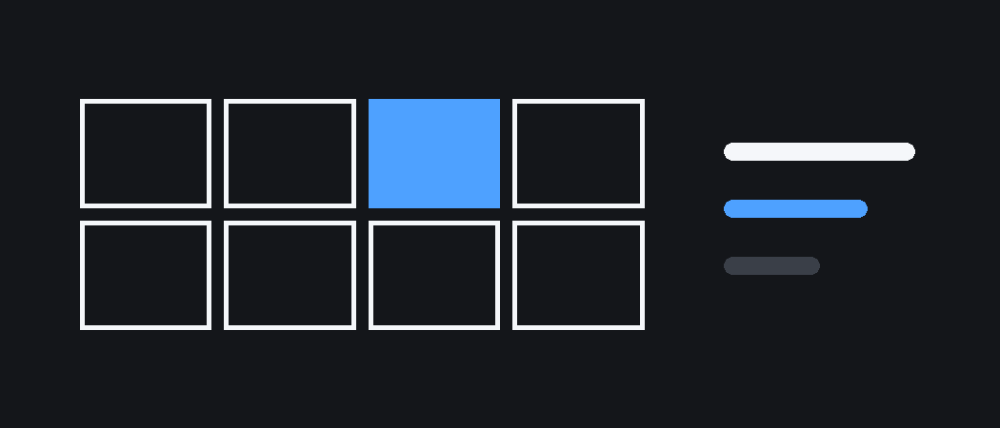

# ComfyUI-FlashAttention4

🌐 **English** · [中文](README_ZH.md)



**One node that routes dense attention through FlashAttention 4 (CuTe DSL) on NVIDIA GPUs.**
No kernel source is compiled here — the SM120/Blackwell kernel bundle is downloaded by
[`kernels`](https://huggingface.co/SecondNatureComputing/flash-attn-4-sm120) on first use.

> 🔴 **Read this before installing:** FA4 is a *dense* attention kernel. On MiniMax-H3 at
> 640×832 / 124 frames / 6 steps, **Kitchen INT8 was faster** (67.9 s vs 116.1 s hot).
> FA4 is close to lossless, not faster-than-quantized. Benchmark on your own workload first —
> [numbers below](#benchmarks).

| Item | Value |
|---|---|
| Version | **0.2.3** |
| License | **MIT** ([`THIRD-PARTY-NOTICES.md`](THIRD-PARTY-NOTICES.md); the kernel bundle is BSD-3-Clause) |
| Host | **ComfyUI ≥ 0.38.0** |
| GPU | NVIDIA **SM80+** (Ampere / Ada / Hopper / Blackwell). Tested on **SM120** (RTX 5070) only |
| Dependencies | `kernels`, `cuda-python`, `nvidia-cutlass-dsl[cu13]`, `quack-kernels`, `apache-tvm-ffi` |
| Registry | [`comfyui-fa4`](https://registry.comfy.org/nodes/comfyui-fa4) |

**What this pack guarantees:** the node loads, patches the MODEL, and either runs FA4 or
falls back to SDPA — loudly, with a counter.
**What it does not guarantee:** that FA4 is faster than your current backend.

---

## 1 · Quick start

### 1.1 Install

| Route | How |
|---|---|
| **Manager** (recommended) | search **FlashAttention4** → Install → restart ComfyUI |
| **Manual** | `cd <ComfyUI>/custom_nodes` → `git clone https://github.com/ZenHG/ComfyUI-FlashAttention4` |
| **Registry** | <https://registry.comfy.org/nodes/comfyui-fa4> |

If you installed through the Manager, dependencies come with the pack. If you cloned
manually (or the first run fails with `ModuleNotFoundError`), install the runtime
dependencies **into the Python that runs ComfyUI**:

```bash
<Python> -m pip install "kernels>=0.9,<0.14" "huggingface-hub==0.36.2" \
    cuda-python "nvidia-cutlass-dsl[cu13]==4.8.1" quack-kernels "apache-tvm-ffi>=0.1.6,<0.2"
```

Restart ComfyUI.

🔴 **Do not `pip install -U kernels` to 0.14+.** It pulls `huggingface-hub` 2.x and
breaks ComfyUI's `diffusers` / `transformers`. Pin `0.12.0` + `hub 0.36.2`.

🔴 **Install into the right Python.** If ComfyUI runs on a specific interpreter (see
`ComfyUI Path` in the startup log), installing into another one does nothing — the node
loads, then fails on the first attention call.

### 1.2 What success looks like

Node search should show **three** nodes:

```
FlashAttention4ModelPatch    (FlashAttention4 Model Patch,     MODEL → MODEL)
FlashAttention4Stats         (FlashAttention4 Stats,           7 INT outputs)
FlashAttention4StatsLine     (FlashAttention4 Stats Line,      STRING)
```

Startup log should show the pack loading, and the **first attention call** should log:

```
[FlashAttention4] installed flash4 on ModelPatcherDynamic
flash_attn.cute is unavailable (No module named 'flash_attn'); trying the SM120 kernel bundle
FlashAttention 4 kernel loaded
```

Seeing `flash_attn.cute is unavailable` is **normal** — that path is only for a source build.
The next line must be `FlashAttention 4 kernel loaded`. If you instead see
`FlashAttention 4 failed, using SDPA`, read [§3.3](#33-it-printed-using-sdpa).

### 1.3 First run

1. Insert **FlashAttention4 Model Patch** in the MODEL chain — after the loader / LoRA /
   sparse-attention pack, before the sampler.
2. (Optional) Add **FlashAttention4 Stats** with `reset=True` somewhere before the sampler.
3. Run. The first attention call JIT-compiles the kernel; on Windows this adds ~30 s once
   per ComfyUI restart.

### 1.4 Proving FA4 actually ran

FA4 falls back to SDPA on unsupported input, so "no error" does not mean "FA4 ran".
Read the counters:

| Output | Pass |
|---|---|
| `fa4` | **> 0** |
| `sdpa_mask` / `sdpa_dtype` / `sdpa_gqa` / `sdpa_headdim` / `sdpa_meta` | **all 0** |
| `kernel_errors` | **0** |

`FlashAttention4 Stats` also prints to the host stdout every 30 s
(`[FlashAttention4] stats {...}`), because a reset node runs *before* the sampler and would
otherwise only ever report zeros.

`FlashAttention4 Stats Line` formats the same counters as one line and appends
`FA4 ACTIVE` or `NOT A CLEAN FA4 RUN`.

### 1.5 Uninstall

Delete `custom_nodes/ComfyUI-FlashAttention4`, remove the five pip packages if nothing else
needs them, restart ComfyUI. Nothing else in the repo is required by the host.

---

## 2 · What falls back to SDPA

| Condition | Why |
|---|---|
| `mask` is not None | FA4 has no attention-mask path |
| dtype is not fp16/bf16 | FA4 is a half-precision kernel |
| tensor is on CPU / meta | no CUDA kernel |
| `head_dim` not in (64, 128) | kernel only supports these |
| `enable_gqa=True` and `kv_heads != q_heads` | FA4 takes the non-packed GQA path only when supported |

Every case increments its own counter, so degradation is visible instead of silent.

---

## 3 · Troubleshooting

### 3.1 The node does not appear

- The folder is nested one level too deep
  (`custom_nodes/ComfyUI-FlashAttention4/ComfyUI-FlashAttention4/`). Move it up.
- ComfyUI was not restarted. Node registration happens at startup only.
- Check the startup log for `Cannot import ... ComfyUI-FlashAttention4`. The traceback names
  the missing module.

### 3.2 `ModuleNotFoundError: No module named 'kernels'` (or `quack`, `cutlass`, `cuda`)

The runtime dependencies are missing **in the interpreter ComfyUI uses**. Run §1.1 with that
exact interpreter. Check with:

```bash
<Python> -c "import kernels, cuda, cutlass, quack, tvm_ffi; print('ok')"
```

### 3.3 It printed `using SDPA`

`kernel_errors` went up. The line before it names the cause:

| Log line | Meaning | Fix |
|---|---|---|
| `No module named 'flash_attn'` + bundle download fails | `kernels` could not fetch the bundle | check network / HF access, then retry |
| `CUDA error` / `no kernel image is available` | no kernel for this arch | see [§4](#4-supported-platforms) |
| `head_dim` / `shape` errors | unsupported tensor shape | the adapter should have caught it; report it |

### 3.4 First call takes ~30 s (or several minutes)

Normal on Windows: the CuTe DSL kernel is JIT-compiled once per ComfyUI restart
(the persistent cache is disabled because it needs `fcntl.flock`). Later runs in the same
session are fast.

### 3.5 FA4 is slower than before

Expected in some cases — see [§5](#benchmarks). FA4 is dense BF16; a quantized or sparse
backend can beat it. Check `FlashAttention4 Stats` to be sure FA4 is even active.

### 3.6 Still stuck

Open an issue with: ComfyUI version, torch/CUDA version, GPU model, the
`[FlashAttention4]` log lines, and the output of `FlashAttention4 Stats`. Do not paste
API keys or local absolute paths.

---

## 4 · Supported platforms

FA4 (CuTe DSL) supports **SM80 / SM89 / SM90 / SM100 / SM110 / SM120** — upstream
`Dao-AILab/flash-attention` documents Hopper and Blackwell, and the bundle's
`interface.py` asserts `arch // 10 in [8, 9, 10, 11, 12]`. The `sm120` in the bundle name
refers to the extra PRs it carries, **not** a hardware limit.

| Platform | Status |
|---|---|
| Windows x86 + SM120/SM121 (RTX 50) | **Tested**: RTX 5070, torch 2.13+cu130, Python 3.12 |
| Linux/Windows x86 + SM80/SM89 (Ampere/Ada) | Expected (SM80 kernel present); **not tested here** |
| Linux/Windows x86 + SM90 (Hopper) | Expected (SM90 kernel present); **not tested here** |
| Linux/Windows x86 + SM100/SM110 (Blackwell DC) | Expected (SM100 kernel present); **not tested here** |
| CPU-only / no GPU | Imports and runs; attention falls back to SDPA |
| AMD ROCm / Apple MPS / Windows-ARM | No FA4 kernel; attention falls back to SDPA |

This node adds **no** arch check: it calls `flash_attn_func` and lets the bundle dispatch.
No matching kernel ⇒ the call raises ⇒ SDPA fallback (counted in `kernel_errors`).

---

## 5 · Benchmarks

Workload: 640×832, 124 frames, 6 steps, `er_sde`, LoRA×2, RTX 5070, ComfyUI
`Prompt executed` seconds. Cold = first run after a restart.

| Backend | Cold | Hot | Note |
|---|---:|---:|---|
| Kitchen INT8 + Spark | 121.7 s | 67.1 s | sparse + quantized dense |
| Kitchen INT8 only | 71.7 s | 67.9 s | quantized dense |
| FA4 only | 126.5 s | **116.1 s** | dense FA4, ~1.7× slower than Kitchen |
| FA4 + Spark | 68.4 s | 65.8 s | FA4 unused — Spark routes dense to Kitchen |

### Step count matters more than the backend

Same graph (Kitchen, LoRA×2, no Spark), only the sigma table changed:

| Steps | Time |
|---:|---:|
| 3 | **39.9 s** |
| 6 | 67.9 s |
| 8 | 94.5 s |

≈ 11 s/step including a fixed ~10 s for VAE decode + save.

### Quality snapshot (640×832×124, seed 12345)

| Run | Body sharpness | High-freq ratio | Temporal SSIM | Seam/body |
|---|---:|---:|---:|---:|
| 3 steps | 31.5 | 0.9719 | 0.9946 | 0.893 |
| 6 steps | 39.7 | 0.9821 | 0.9784 | 0.715 |
| FA4 6 steps | 41.7 | 0.9818 | 0.9765 | 0.712 |

3 steps is ~21 % softer than 6 steps but has the steadiest frames; 8 steps adds no
measurable detail over 6.

### Interaction with sparse packs

A sparse pack (e.g. Spark-H3) installs its own per-block attention patch. FA4 then **never
sees those calls** — in our tests Spark kept logging `comfy_kitchen_calls` and the FA4
counter stayed 0. Set the sparse pack's `dense_backend` explicitly if you want FA4 to serve
its dense path; `inherit` does **not** mean FA4.

---

## 6 · Not affiliated with `comfyui-flash-attention4`

The registry id `comfyui-flash-attention4` belongs to a different, unmaintained pack
(`sorryhyun`, v1.0.0, 2026-03). This project is **`comfyui-fa4`** — a separate
implementation that ships no kernel source and installs the SM120 bundle through `kernels`.

---

## 7 · License

MIT for this node pack. The FA4 kernel bundle is BSD-3-Clause (Dao-AILab).